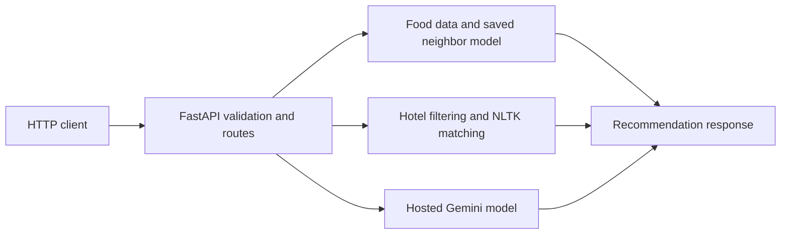

# Travel, Hotel & Food Recommendation API

**A FastAPI prototype that brings three recommendation approaches behind HTTP endpoints.**

The project demonstrates how a backend can combine a saved nearest-neighbor model, rule-and-text matching, and a hosted language model. It is useful for comparing their data requirements and response behavior in a single application.

## Available endpoints

| Method and path | Input | Behavior |
|---|---|---|
| `GET /` | None | Welcome response |
| `POST /food_recommendations/` | `title` | Look up a known food and return neighboring items |
| `POST /hotel_recommendations/` | `city`, `number_of_guests`, `features` | Filter hotels and rank amenity-word overlap |
| `POST /recommend_travel` | `budget`, `starting_location`, `group_size`, `preference_type` | Send a travel prompt to Gemini |

## Architecture



## Prepare the environment

Download and extract the repository. Use a Python environment compatible with the included pickle artifacts.

```bash
python -m pip install -r requirements.txt
python -m nltk.downloader punkt stopwords wordnet
```

Some NLTK versions also require `punkt_tab`. Run from the repository root so the relative `food/` and `hotel/` paths resolve.

Before enabling travel generation, replace the inline Gemini configuration in `main.py` with your own securely supplied credential and a currently available model. The source does not currently read an API-key environment variable. Never reuse credentials embedded in repository history.

## Start and try it

```bash
python -m uvicorn main:app --reload
curl http://127.0.0.1:8000/
```

Use the generated API documentation at `http://127.0.0.1:8000/docs` to submit requests. A hotel request has this shape:

```json
{
  "city": "Mumbai",
  "number_of_guests": 2,
  "features": "wifi breakfast"
}
```

Results depend on matching records in the included hotel dataset. Food titles must match existing dataset entries.

## Repository guide

- `main.py`: API startup, data loading, recommendation helpers, and routes.
- `food/`: saved food records, rating matrix, and nearest-neighbor model.
- `hotel/`: saved hotel records.
- `food-recommendation-system-easy-comprehensive.ipynb` and `hotel-recommender.ipynb`: development notebooks.
- `place_recommendation.py` and `recommendations.py`: related experiments.

## Current limitations

The travel endpoint returns cleaned model text inside `recommendation`; it does not parse and validate that text against a response schema. Hotel matching uses exact city/guest filters and token overlap. There is no live availability, booking, or price-verification integration. Authentication, restrictive CORS, credential management, and stronger error handling are needed before exposing the service publicly.

Only load trusted pickle artifacts. Dependency and model-provider compatibility should be checked when recreating this older prototype.
